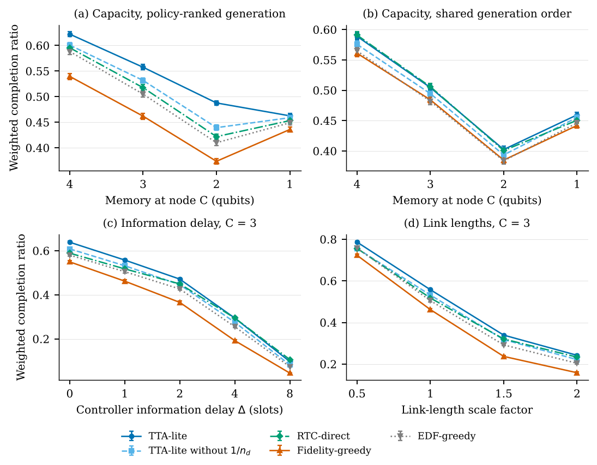

# TTA-REO: Relational Entanglement Orchestration for Quantum Networks

Simulation code and data for the paper:

> **Swarup Roy and Rupak Mukherjee**, "तत् त्वम् असि (*Tat Tvam Asi*)-Inspired Relational Entanglement Orchestration for Quantum Communication Networks," preprint, 2026. arXiv: *link to be added*

Quantum networks must share fragile, short-lived entanglement among many requests that compete for the same memories and links. TTA-REO values each entangled resource by how much it raises a request's chance of being completed in time, using only the information that has actually reached the decision point. This repository contains the discrete-time simulator used in the paper, the scripts that run all four experiments, and the raw results behind every reported number.



*Weighted completion ratio of five allocation policies (300 seeds each, 95% confidence intervals): (a) memory at the shared node C, (b) the same with a shared generation order, (c) controller information delay, (d) link length.*

---

## Contents

| File | Purpose |
|---|---|
| `tta_sim.py` | The simulator: network model, request generator, five policies, `simulate()`. All parameters are in `PARAMS`. |
| `example_single_run.py` | Short worked example. Start here. |
| `sweep.py` | Runs the paper's four experiments (300 seeds each) with bootstrap intervals and Holm-corrected Wilcoxon tests. |
| `make_figures.py` | Builds the results figure and LaTeX table rows from the summaries. |
| `results/` | Per-seed outcomes (`*_raw.json`) and statistics (`*_summary.json`) used in the paper. |
| `TUTORIAL.pdf` | Step-by-step tutorial with real inputs and outputs. |
| `requirements.txt` | Python dependencies. |

---

## Installation

Requires Python 3.9 or later (tested with Python 3.13, NumPy 2.5, SciPy 1.18, Matplotlib 3.11).

```bash
git clone https://github.com/<your-username>/TTA-REO-simulation.git
cd TTA-REO-simulation
python -m venv venv
source venv/bin/activate          # Windows: venv\Scripts\activate
pip install -r requirements.txt
```

## Quick start

```bash
python example_single_run.py
```

Expected output (abbreviated):

```
Seed 1000, C capacity 3, 205 requests
Policy             WCR    d1     d2     d3
EDF-greedy       0.598  0.23   0.93   0.64
Fidelity-greedy  0.545  0.38   0.81   0.42
TTA-lite         0.606  0.20   0.87   0.55
TTA-lite-noCP    0.586  0.20   0.89   0.50
RTC-direct       0.631  0.28   0.93   0.59
```

WCR is the weighted completion ratio: the share of request weight completed by its deadline. A single seed is one random sample; the paper's conclusions use 300 seeds per setting.

## Reproducing the paper

```bash
python sweep.py              # all four experiments, about 6 minutes on 2 CPU cores
python make_figures.py       # figure and table rows into ./output
```

Or run one experiment at a time:

| Command | Experiment | What varies |
|---|---|---|
| `python sweep.py capacity` | A | Memory at node C: 4, 3, 2, 1 qubits |
| `python sweep.py shared` | B | As A, with one generation order shared by all policies |
| `python sweep.py info` | C | Controller report delay: 0, 1, 2, 4, 8 slots |
| `python sweep.py distance` | D | All link lengths × 0.5, 1, 1.5, 2 |

The simulation is deterministic: rerunning reproduces the per-seed results in `results/` exactly.

## Using the simulator in your own code

```python
import copy
from tta_sim import PARAMS, simulate, make_workload

P = copy.deepcopy(PARAMS)
P["INFO_DELAY"] = 2                  # controller information 2 slots old
P["EDGES"]["CF"] = (40.0, 0.92)      # CF link: 40 km, initial quality 0.92

workload = make_workload(1000, P)    # requests for seed 1000
result = simulate("TTA-lite", 1000, 3, P, workload)   # policy, seed, qubits at C
print(result)
# {'wcr': ..., 'n': ..., 'cr_d1': ..., 'cr_d2': ..., 'cr_d3': ...}
```

Policies: `"EDF-greedy"`, `"Fidelity-greedy"`, `"TTA-lite"`, `"TTA-lite-noCP"`, `"RTC-direct"`.

## Model summary

- **Network:** six nodes A–F; links AC 20 km, CD 25 km, BE 15 km, EF 10 km, CF 30 km, BC 20 km. Four memory qubits per node; node C varied.
- **Requests:** A–D Bell pair (swap at C), B–E–F GHZ state (fusion at E), C–F Bell pair; each with a fidelity threshold, deadline and weight.
- **Distance and delay:** 0.1 ms slots; success probability falls with fibre loss (0.2 dB/km); heralding takes ⌈L / 20 km⌉ slots; swap and fusion outcomes must reach the end nodes before a request counts as complete.
- **Information:** the controller learns outcomes after a report delay and can only act on what it knows.
- **Decay:** stored quality decays exponentially; pairs are discarded after 2 ms.

See `TUTORIAL.pdf` and the paper for full details.

## Limitations

This is an abstract model for comparing allocation rules, not a physical-layer simulator. Quality is a scalar stand-in for fidelity, operation success rates are fixed, the report delay is uniform, and only one topology is modelled. For physical-layer studies, see [NetSquid](https://netsquid.org) or [SeQUeNCe](https://github.com/sequence-toolbox/SeQUeNCe).

## Citation

```bibtex
@misc{roy2026ttareo,
  author = {Roy, Swarup and Mukherjee, Rupak},
  title  = {Tat Tvam Asi-Inspired Relational Entanglement Orchestration for Quantum Communication Networks},
  year   = {2026},
  note   = {Preprint}
}
```

## Contact

- Swarup Roy, Department of Computer Science and Engineering, Tezpur University — swarup@tezu.ernet.in
- Rupak Mukherjee, Department of Physics, Sikkim University — rmukherjee@cus.ac.in

## License

License to be added.
